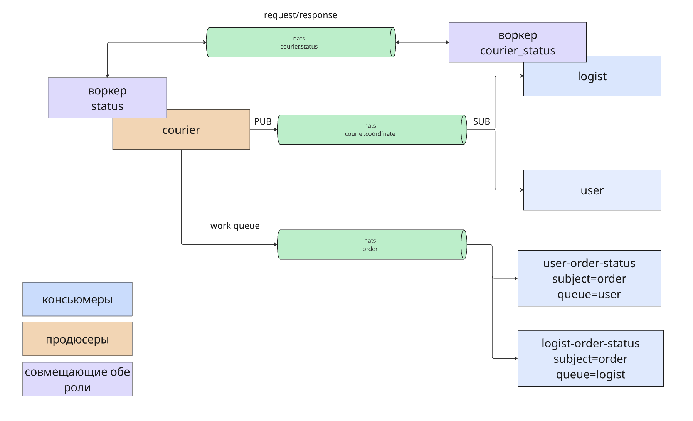
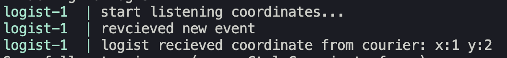
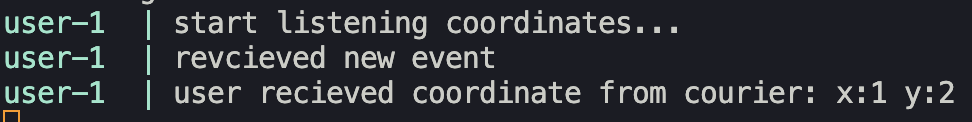
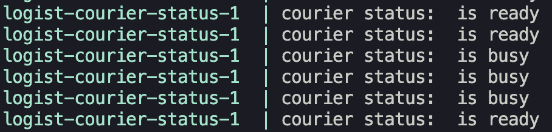
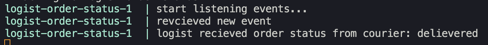
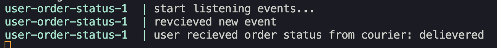

#
Описание: cистема для доставки заказа курьером.
#
Бизнес-логика:
- курьер отправляет координату в шину (nats) на это событие подписаны личный кабинет логиста и личный кабинет покупателя. По координате они видят где находится курьер.

- логист отправляет запрос к курьеру через nats с ожиданием ответа со статусом курьера: готов ли курьер взять новый заказ.

- курьер отправляет статус заказа (доставлен/в доставке) через шину (nats). Это событие слушают сервис logist и сервис user, чтобы у логиста и покупателя отобразилас актуальная информация о статусе заказа.

#

Общая схема:
    

0. Выполняем ```docker compose build```

1. Поднимаем сервисы командой: ```docker compose up```

2. **pub/sub**.

Отправим http-запрос со значениями координат курьера в сервис ```courier```:

```curl -X POST -H "Content-Type: application/json" -d '{"x": 1, "y": 3}' http://127.0.0.1:8080/coordinates```

видим, что сервисы ```logist``` и ```user```, для которых реализован паттер pub/sub с сервисом ```courier```, получили значение координат. Следовательно ```pub/sub``` работает корректно:

```logist```:



```user```:




3. **request/response**.

Откроем консоль сервиса ```logist-courier-status```, этот сервис отправляет по nats сообщение сервису courier-status чтобы узнать доступен ли курьер для нового заказа. Видим, что канал nats работает в обе стороны. Мы отправляем запрос на статус и сразу получаем ответ. Таким образом реализация request/response работает корректно.

```logist-courier-status```:




4. **group consumers/queue**

Отправим http-запрос со значением статуса заказа в сервис```courier```:

```curl -X POST -H "Content-Type: application/json" -d '{"status": "delievered"}' http://127.0.0.1:8080/order```

Видим, что консьюмеры, подписанные на subject order.status (user-order-status и logist-order-status) оба получили свой экземпляр сообщения, поскольку у каждого из этих консьюмеров указана своя ```queue```.

```logist-order-status```:



```user-order-status```:



